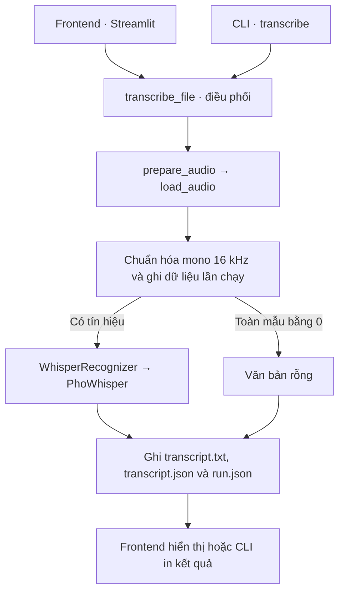

# Pipeline của bản demo đang chạy

Frontend và CLI cùng gọi hàm Python `transcribe_file`. Chạy demo chỉ cần một tiến trình Streamlit. Khi bấm **Nhận dạng**, trang đợi backend xử lý rồi hiển thị văn bản và nút tải TXT.

| Thứ tự | Mở file | Công việc |
|---|---|---|
| 1 | [frontend/app.py](../frontend/app.py) | Chọn mẫu hoặc lưu upload vào thư mục tạm, nghe lại và gửi đường dẫn file cho backend. Demo giới hạn 5 phút và 100 MiB. |
| 2 | [pipeline.py](../backend/asr_engine/app/pipeline.py) | Điều phối một lần chạy. Gọi chuẩn hóa, tạo thư mục kết quả riêng và ghi trạng thái. |
| 3 | [audio.py](../backend/asr_engine/app/audio.py) | Kiểm tra đầu vào, đọc WAV bằng SciPy hoặc giải mã MP3/MP4 bằng FFmpeg, chuẩn hóa và kiểm tra thời lượng. |
| 4 | [recognizer.py](../backend/asr_engine/app/recognizer.py) | Nạp checkpoint, sinh bản chép tiếng Việt, kiểm tra mốc thời gian và trả kết quả. |
| 5 | [pipeline.py](../backend/asr_engine/app/pipeline.py) | Ghi kết quả rồi trả dữ liệu cùng đường dẫn thư mục cho bên gọi. |

Demo lưu kết quả ở `outputs/demo/<run_id>/`. Mở `transcript.txt` để đọc, `transcript.json` để xem từng đoạn và thời gian xử lý, hoặc `normalized.wav` để nghe đúng tín hiệu đưa vào model. Nếu lỗi xảy ra trước khi tạo thư mục kết quả, giao diện hiện thông báo trực tiếp. Nếu model gặp lỗi sau khi chuẩn bị audio, xem `run.json` của lần chạy đó.

[CLI](../backend/asr_engine/cli.py) cũng hỗ trợ `inspect` (chỉ kiểm tra audio) và `prepare` (xuất audio chuẩn hóa). Lệnh khởi động demo nằm trong [README](../README.md). Thiết kế mở rộng về HTTP API, hàng đợi và database nằm trong [bản đề xuất ban đầu](design/PIPELINE_DE_XUAT_VI.md).
