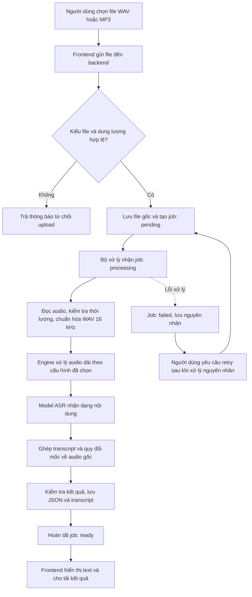
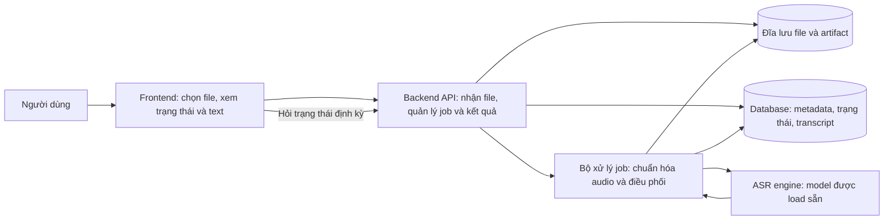
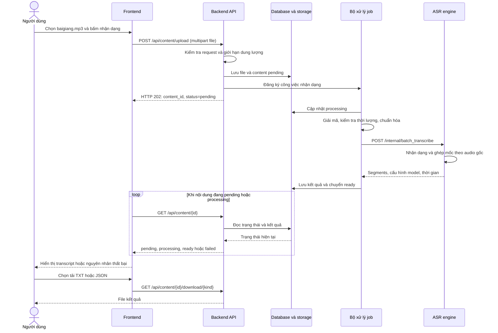
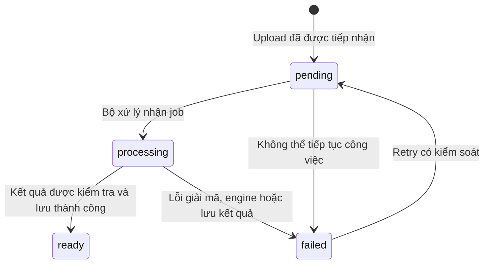
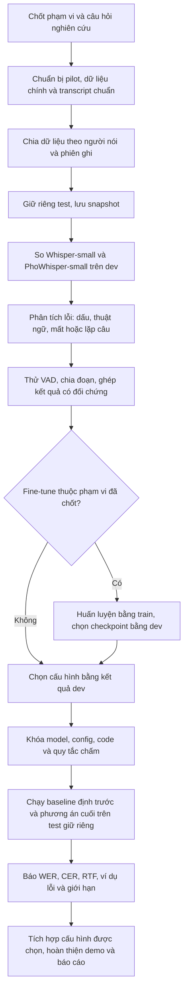

# Pipeline và luồng dự án ASR tiếng Việt

Trạng thái: đã triển khai CLI chuẩn hóa audio và gọi model ở bước đầu; các sơ đồ sản phẩm/API bên dưới vẫn là thiết kế. Đã kiểm tra xử lý WAV và cơ chế long-form bằng test không tải checkpoint; chưa xác minh nhận dạng lời nói thật bằng PhoWhisper trên workspace. Xem [hướng dẫn chạy](GETTING_STARTED_VI.md) và [môi trường](environment.md).

Dự án được xây trong `/home/dev/tts`; `/home/dev/asr/ASR` là nguồn tham khảo. Mục tiêu vẫn là chuyển giọng nói thành văn bản dù thư mục có tên `tts`.

Tài liệu này diễn giải luồng thực hiện của [kế hoạch chi tiết](ASR_PROJECT_PLAN_VI.md). Cần phân biệt: pipeline sản phẩm xử lý file người dùng; pipeline thực nghiệm giúp chọn và đánh giá mô hình.

## 1. Luồng sản phẩm tổng quát



Ví dụ: người dùng chọn `baigiang.mp3`, dài 5 phút. Frontend gửi nội dung file tới backend. Backend lưu file, tạo công việc và trả mã để frontend theo dõi. Bộ xử lý chuẩn hóa audio, gọi engine, lưu transcript. Frontend nhận trạng thái hoàn tất rồi hiển thị văn bản.

Mũi tên lỗi ở sơ đồ áp dụng cho toàn bộ công việc sau khi nhận job, gồm giải mã, gọi model, ghép và lưu kết quả. Retry dùng lại nguồn đã lưu và tạo một lần xử lý mới có mã riêng; không bắt người dùng tải lại file khi nguồn vẫn còn hợp lệ.

Đầu vào mục tiêu: tiếng Việt, một người nói, thu rõ, WAV/MP3, tối đa 10 phút và 100 MiB theo phạm vi đề xuất. Backend kiểm tra thời lượng thực khi giải mã; giới hạn trên giao diện không thay thế kiểm tra ở backend.

## 2. Mỗi thành phần chịu trách nhiệm gì?



| Thành phần | Công việc chính | Kết quả trả về |
|---|---|---|
| Frontend | Chọn file, gửi upload, hỏi trạng thái, hiển thị text, tải file | Nội dung người dùng nhìn thấy |
| Backend API | Kiểm tra request, lưu nguồn, tạo job, cung cấp kết quả và quyền truy cập | Content ID, trạng thái, transcript, link tải |
| Bộ xử lý job | Đọc file đã lưu, gọi ffmpeg, gọi engine, kiểm tra và lưu đầu ra | Job hoàn tất hoặc lỗi có nguyên nhân |
| ASR engine | Load checkpoint một lần, xử lý vùng/đoạn audio và sinh text | Segments, mốc thời gian, thông tin model và thời gian xử lý |
| Database | Giữ nội dung, trạng thái, cấu hình, các lần chạy và transcript | Dữ liệu có thể truy vấn lại |
| File storage | Giữ audio gốc, audio chuẩn hóa và artifact | File để nghe lại, kiểm tra và tải xuống |

Tách trách nhiệm không có nghĩa phải dựng nhiều máy. Bản local có thể chạy tất cả trên một máy, khởi đầu một inference tại một thời điểm. Việc điều phối job sẽ được triển khai theo mức độ bền vững đã chọn trong kế hoạch.

## 3. Luồng gọi API

Các endpoint dưới đây là thiết kế dự kiến, chưa được triển khai trong thư mục `tts`.



`multipart file` nghĩa là gửi các byte của file người dùng đã chọn. HTTP 202 có nghĩa backend đã tiếp nhận công việc; lúc này chưa có nghĩa nhận dạng xong. Frontend có thể bắt đầu hỏi trạng thái trong lúc bộ xử lý đang chạy; sequence diagram chỉ mô tả các quan hệ chính.

## 4. Pipeline xử lý audio bên trong

| Bước | Đầu vào | Bạn cần làm | Đầu ra |
|---|---|---|---|
| 1. Nhận file | File từ trình duyệt | Kiểm tra upload, lưu bằng mã nội dung riêng | File gốc và content ID |
| 2. Đọc metadata | File gốc | Dùng ffprobe kiểm tra đọc được, thời lượng, kênh, sample rate | Metadata hoặc lỗi định dạng/thời lượng |
| 3. Chuẩn hóa | Audio đọc được | Giải mã bằng ffmpeg về WAV PCM mono 16 kHz theo cấu hình engine | Audio chuẩn hóa, cùng timeline với file gốc |
| 4. Xác định vùng/đoạn | Audio chuẩn hóa | Dùng đường long-form baseline hoặc cấu hình VAD/chia đoạn được chọn trên dev | Các đoạn kèm vị trí trên bản gốc |
| 5. Nhận dạng | Audio từng đoạn hoặc đường long-form của runtime | Gọi model và lưu cấu hình suy luận | Text và thông tin mốc nếu được hỗ trợ |
| 6. Ghép | Kết quả nhận dạng | Đưa mốc về bản gốc, kiểm tra thiếu/lặp ở ranh giới | Transcript thống nhất |
| 7. Xác minh đầu ra | Transcript và segments | Kiểm tra schema, số hữu hạn, thứ tự mốc, thời lượng | Kết quả hợp lệ hoặc lỗi |
| 8. Lưu và xuất | Kết quả hợp lệ | Lưu JSON/TXT; tạo SRT khi mốc đã kiểm tra | Artifact và trạng thái ready |

Ví dụ mô hình đầu tiên: `vinai/PhoWhisper-small`, chạy bằng Transformers; đối chứng với `openai/whisper-small`. Mô hình dùng cuối cùng được chọn từ thực nghiệm, chưa được chốt là tốt hơn trong dự án này. Model/revision và cấu hình phải được ghi trong kết quả mỗi lần chạy.

Baseline cần có đường xử lý file dài đúng của runtime ngay từ đầu. VAD và cách chia/ghép đề xuất là các cấu hình thí nghiệm tiếp theo; chỉ đưa vào cấu hình cuối khi đã kiểm tra trên dev. Mục tiêu đầu tiên là một script độc lập có thể nhận dạng đầy đủ file ngắn và dài.

VAD phát hiện vị trí có tiếng nói, ASR nhận dạng nội dung lời nói. Khi bỏ qua khoảng lặng, vẫn phải giữ offset của mỗi vùng trên file gốc. Ví dụ vùng nói bắt đầu ở giây 40, model trả mốc cục bộ giây 2 thì mốc gốc là giây 42.

Timestamp từ model cũng cần kiểm tra. Nếu cấu hình chỉ cho mốc ước lượng theo vùng, ghi rõ độ hạt đó; không chia đều thời lượng rồi trình bày như mốc được nhận dạng chính xác.

## 5. Trạng thái và xử lý các trường hợp đặc biệt



| Tình huống | Cách xử lý dự kiến |
|---|---|
| File sai loại hoặc quá lớn khi nhận upload | Từ chối request với thông báo rõ, dọn file tạm nếu có |
| File hỏng hoặc vượt thời lượng khi worker đọc | Chuyển failed, ghi loại lỗi, không gọi ASR |
| Phát hiện không có lời nói theo cấu hình đã chọn | Có thể ready với `segments=[]`, `text=""`, cảnh báo `no_speech_detected`; cần kiểm tra lỗi phát hiện trên tập giới hạn |
| Engine chưa sẵn sàng hoặc hết bộ nhớ | Chuyển failed, ghi nguyên nhân; cho retry sau khi xử lý nguyên nhân |
| Backend/worker restart giữa chừng | Nhận diện job dang dở; phục hồi theo cơ chế đã chọn hoặc đánh dấu failed để retry |
| Retry | Ghi attempt ID/cấu hình mới; không ghép lẫn artifact của hai lần xử lý |
| Người dùng sửa text | Lưu bản chỉnh sửa riêng; giữ kết quả model gốc để đối chiếu |

Trạng thái `ready` cho biết xử lý đã hoàn tất và đầu ra hợp lệ về cấu trúc. Độ chính xác nội dung được đánh giá bằng bộ dữ liệu có reference; không thể suy ra chỉ từ trạng thái job.

## 6. Dữ liệu được lưu ở đâu trong thiết kế?

Đường dẫn dự kiến, chưa được tạo:

```text
tts/
├── backend/storage/<content_id>/
│   ├── source.mp3                   # Hoặc source.wav: file gốc
│   └── runs/<attempt_id>/
│       ├── normalized.wav           # Audio chuẩn hóa
│       ├── transcript.json          # Kết quả có cấu trúc và metadata
│       ├── transcript.txt           # Văn bản để đọc/tải
│       └── transcript.srt           # Khi đã kiểm tra mốc thời gian
├── data/                            # Dữ liệu nghiên cứu có manifest và split
└── experiments/<run_id>/             # Cấu hình, prediction và metrics
```

Database dự kiến lưu content ID, đường dẫn nguồn, trạng thái, thông tin lần chạy, lỗi nếu có và segments với `start/end` dạng số. Lưu thêm model ID/revision, runtime, precision và cấu hình chia đoạn để truy vết.

Audio sản phẩm và dữ liệu nghiên cứu có mục đích khác nhau. Upload không tự động thêm vào train/test; bộ nghiên cứu cần nguồn, quyền sử dụng và reference đã kiểm tra.

## 7. Pipeline thực nghiệm phục vụ đồ án



| Chỉ số | Câu hỏi nó giúp trả lời |
|---|---|
| WER | Có bao nhiêu đơn vị văn bản bị thay sai, thêm hoặc thiếu theo quy tắc tách đã công bố? |
| CER | Lỗi ký tự, kể cả dấu tiếng Việt, ở mức nào? |
| RTF | Thời gian xử lý chiếm bao nhiêu phần thời lượng audio? |
| Lỗi ở ranh giới đoạn | Cách chia/ghép có làm mất hoặc lặp nội dung không? |
| Sai lệch timestamp | Văn bản có khớp vị trí lời nói trong audio không? |

Chọn model và tham số bằng dev. Test dùng để báo cáo cuối sau khi khóa cấu hình; nếu liên tục dùng test để chọn phương án thì cần một test mới độc lập để kiểm tra kết luận cuối. Bản model gốc và bản người dùng sửa không được trộn khi chấm chất lượng ASR.

## 8. Thứ tự triển khai để có bản chạy được

1. **CLI audio → text:** chạy model đầu tiên trên file ngắn rồi file dài, lưu JSON và thời gian.
2. **Bộ chấm:** reference, normalizer, WER/CER và manifest dữ liệu pilot.
3. **Baseline:** so hai model, ghi tài nguyên và chọn cấu hình tạm trên dev.
4. **Engine API:** endpoint nội bộ, model load sẵn, schema và lỗi rõ ràng.
5. **Backend upload/job:** lưu nguồn, chuẩn hóa, gọi engine, cập nhật trạng thái và tải kết quả.
6. **Frontend:** chọn file, hỏi trạng thái, đọc transcript, nghe lại và tải TXT/JSON.
7. **Cải tiến và phụ đề:** thử VAD/chia đoạn, kiểm tra timeline, xuất SRT khi đạt tiêu chí đã chốt.
8. **Đánh giá cuối:** chạy test giữ riêng, lưu cấu hình/kết quả, hoàn thiện demo và báo cáo.

Hiện đã có mã CLI ở bước 1 và các kiểm thử xử lý tín hiệu; cần checkpoint và bản ghi thật để xác minh nhận dạng. Bộ chấm, API và giao diện ở các bước sau chưa được triển khai. Đối chiếu P01–P02 trong [kế hoạch chi tiết](ASR_PROJECT_PLAN_VI.md#p01--học-audio-qua-bài-tập-thực-hành).
