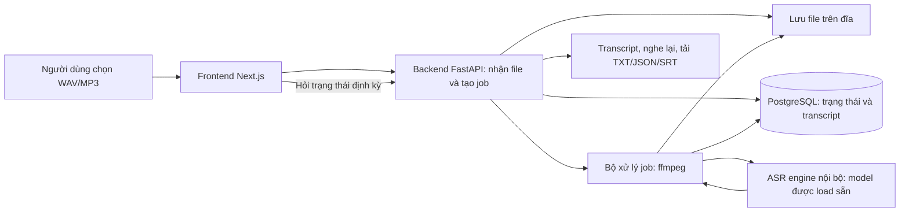

# Kế hoạch chi tiết đồ án ASR tiếng Việt cho người mới

Sơ đồ và luồng xử lý: [Pipeline dự án ASR](ASR_PIPELINE_VI.md).

Ngày lập: 11/11/2026. Cập nhật bước đầu: đã triển khai CLI đọc/chuẩn hóa WAV, xem waveform và gọi Whisper/PhoWhisper; đã tạo môi trường và test xử lý tín hiệu/long-form. Chưa tải được checkpoint, chưa thử nhận dạng giọng nói thật hay chạy benchmark. API và giao diện vẫn là kế hoạch. Xem [hướng dẫn chạy](GETTING_STARTED_VI.md) và [môi trường đã kiểm tra](environment.md).

Tài liệu được lưu tại `/home/dev/tts/docs/ASR_PROJECT_PLAN_VI.md`, phục vụ dự án mới trong `/home/dev/tts`. Repository `/home/dev/asr/ASR` chỉ là nguồn tham khảo về kiến trúc và luồng xử lý; không mặc định dùng lại mã nguồn hay triển khai trong repository đó. Tên thư mục `tts` là vị trí lưu do người dùng chọn; mục tiêu trong kế hoạch vẫn là ASR/STT: giọng nói thành văn bản.

Các quyết định về mô hình cuối cùng, tốc độ và fine-tune cần được chốt sau khi biết máy chạy, thời hạn và yêu cầu của giảng viên. Các con số về dữ liệu, thời gian và giới hạn upload dưới đây là mục tiêu lập kế hoạch, không phải kết quả đã đo hay yêu cầu bắt buộc của ASR.

## 1. Bạn sẽ xây cái gì?

Một ứng dụng nhận file ghi âm bài giảng/thuyết trình tiếng Việt và chép lời nói thành văn bản. Người dùng tải file lên, đợi xử lý, đọc kết quả theo thời gian, nghe lại để đối chiếu và tải transcript/phụ đề xuống.

Ví dụ:

```text
Đầu vào: baigiang.mp3, dài 5 phút, một người giải thích về cơ sở dữ liệu.
Đầu ra: văn bản đã nhận dạng và các đoạn kèm mốc thời gian.
Xuất file: transcript.txt, transcript.json, transcript.srt.
```

Đây là chép lời nói trong cùng ngôn ngữ: tiếng Việt → văn bản tiếng Việt. Cần chép đúng nội dung thực sự được nói, kể cả khi diễn đạt chưa tròn câu.

Đề tài dự kiến:

> Xây dựng và đánh giá hệ thống nhận dạng tiếng nói tiếng Việt cho bản ghi bài giảng một người nói, với thực nghiệm về chia đoạn và xử lý khoảng lặng.

Câu hỏi nghiên cứu chính:

> Với cùng một mô hình, cách phát hiện vùng có lời nói và chia đoạn ảnh hưởng thế nào đến lỗi nhận dạng, mất/lặp nội dung và thời gian xử lý bản ghi bài giảng?

Câu hỏi phụ: giữa Whisper-small và PhoWhisper-small, lựa chọn nào phù hợp hơn với dữ liệu và phần cứng của đồ án?

Bạn cần thống nhất với giảng viên xem hướng đánh giá/cải thiện pipeline có đáp ứng yêu cầu đóng góp của khoa hay phải có fine-tune. Tên và phạm vi cuối cùng phụ thuộc quyết định đó.

## 2. Phạm vi đầu vào và đầu ra

| Nội dung | Phạm vi bản đầu |
|---|---|
| Bối cảnh | Bài giảng/thuyết trình, ưu tiên lĩnh vực CNTT bạn hiểu |
| Ngôn ngữ | Chủ yếu tiếng Việt; đánh dấu riêng đoạn có thuật ngữ tiếng Anh |
| Số người | Một người nói trong một file; dữ liệu tổng thể gồm nhiều người |
| Cách nói | Giải thích tự nhiên, có ngập ngừng; thêm lời đọc làm nhóm phụ |
| Âm thanh | Nghe rõ bằng tai, micro gần người nói, nhiễu nền nhẹ |
| Định dạng upload | WAV và MP3 |
| Độ dài | Kiểm tra với file ngắn; sản phẩm cuối nhắm tới tối đa 10 phút/file |
| Dung lượng | Đề xuất tối đa 100 MiB/file, kiểm tra thêm thời lượng sau giải mã |
| Xử lý | Upload xong rồi nhận dạng; ban đầu một job ASR tại một thời điểm |
| Transcript | Nội dung nhận dạng gốc và bản người dùng sửa được lưu riêng |
| Mốc thời gian | Theo đoạn; độ chính xác phải được kiểm tra khi tích hợp |
| Xuất | TXT, JSON; SRT khi có mốc thời gian đạt mức sử dụng đã công bố |

Các tình huống ngoài phạm vi đánh giá chính: hội thoại chồng tiếng, cuộc họp nhiều người, hát/nhạc, bản thu rất xa micro, đa ngôn ngữ liên tục. Vẫn có mẫu thử giới hạn để biết hệ thống phản ứng ra sao; không hứa chất lượng ở các tình huống này.

Giọng vùng miền: ghi nhận thành phần người nói thật sự thu được, không suy rộng thành chất lượng cho mọi vùng miền. Nếu chỉ có ít người ở một nhóm, trình bày đó là quan sát ban đầu.

Tiêu chí kết thúc bản đầu: người khác có thể upload một file trong phạm vi, nhận transcript hoặc thông báo lỗi rõ ràng, tải TXT/JSON và xem được trạng thái xử lý.

## 3. Các khái niệm phải hiểu trước khi code

| Khái niệm | Nghĩa và việc bạn dùng nó để làm |
|---|---|
| ASR / STT | Chuyển lời nói trong audio thành văn bản |
| TTS | Tạo giọng nói từ văn bản; không cần cho mục tiêu hiện tại |
| Transcript | Văn bản chép lại lời nói |
| Ground truth / reference | Văn bản đúng do người nghe kiểm tra, dùng để chấm mô hình |
| Pretrained model | Mô hình tác giả đã huấn luyện và cho tải trọng số |
| Checkpoint | Bộ trọng số và cấu hình của một phiên bản mô hình |
| Inference | Đưa file mới vào mô hình đã có để lấy kết quả |
| Fine-tuning | Huấn luyện tiếp checkpoint bằng cặp audio–transcript của mình |
| Training from scratch | Huấn luyện từ trọng số khởi tạo; không thuộc kế hoạch cơ sở này |
| Baseline | Cấu hình ban đầu làm mốc so sánh |
| VAD | Phát hiện khoảng có tiếng nói; chưa nhận biết các từ được nói |
| Chunk | Một đoạn audio đưa vào một lần xử lý |
| Timestamp | Vị trí bắt đầu/kết thúc của đoạn trên audio gốc |
| Sample rate | Số mẫu tín hiệu mỗi giây; 16 kHz là 16.000 mẫu/giây |
| Mono / stereo | Một/hai kênh audio; khác với số người đang nói |
| Token | Đơn vị văn bản mà mô hình dự đoán; không nhất thiết là một từ |
| Encoder / decoder | Phần mã hóa đặc trưng audio và phần sinh chuỗi token văn bản |
| Log-Mel spectrogram | Biểu diễn tín hiệu theo thời gian–tần số để mô hình xử lý |
| WER / CER | Tỉ lệ lỗi theo đơn vị từ/quy tắc tách đã công bố, và theo ký tự |
| RTF | Thời gian xử lý chia thời lượng audio; nhỏ hơn là nhanh hơn |
| Quantization | Lưu/tính trọng số với độ chính xác số thấp hơn; cần đo lại tốc độ và lỗi |
| Overfitting | Tốt trên dữ liệu đã học nhưng kém trên dữ liệu mới |
| Data leakage | Thông tin từ dữ liệu kiểm thử lọt vào quá trình học/chọn cấu hình |

Bài tập nhập môn: mở một WAV, xem sample rate/kênh/thời lượng, vẽ waveform và nghe lại một đoạn. Bạn hoàn thành khi giải thích được vì sao file stereo chưa chắc chứa hai người, và vì sao đổi tên MP3 thành WAV không chuyển định dạng audio.

Tài liệu học về tín hiệu: [Hugging Face — Introduction to audio data](https://huggingface.co/learn/audio-course/en/chapter1/audio_data).

## 4. Chọn mô hình nào?

### 4.1. Quyết định khởi đầu

- Mô hình chạy thử đầu tiên: `vinai/PhoWhisper-small`.
- Mô hình đối chứng chính: `openai/whisper-small`, bản multilingual.
- Nếu máy không đáp ứng: thử cặp `PhoWhisper-base` và `Whisper-base` trước; sau đó xác định có thể benchmark small trên máy khác không.
- Nếu còn tài nguyên: thêm một mô hình lớn hơn như một mốc tham khảo, sau khi hoàn tất so sánh chính.

Đây là lựa chọn để bắt đầu thực nghiệm, chưa khẳng định PhoWhisper thắng trên bài giảng của bạn. PhoWhisper được tác giả thích nghi cho tiếng Việt từ Whisper; phiên bản small có khoảng 244 triệu tham số. Hai mô hình small giúp có một đối chứng gần nhau về quy mô. [Nguồn PhoWhisper](https://github.com/VinAIResearch/PhoWhisper), [Whisper-small](https://huggingface.co/openai/whisper-small).

Trọng số pretrained tải từ trang mô hình. Audio upload là dữ liệu mới để suy luận; tải file lên ứng dụng không tự động huấn luyện mô hình.

### 4.2. Vì sao không chốt ngay mô hình lớn nhất?

Bạn cần biết bộ nhớ, tốc độ, lỗi trên audio thật và khả năng triển khai. Mô hình tốt trên một benchmark công khai chưa chắc là lựa chọn tốt nhất cho máy và dữ liệu của bạn. Bảng kết quả trong tài liệu tác giả là thông tin tham khảo; số liệu đồ án phải do bạn chạy và ghi lại.

Whisper có thể sinh thêm nội dung hoặc lặp văn bản; cần kiểm tra trường hợp im lặng và ngoài phạm vi. [Model card Whisper](https://github.com/openai/whisper/blob/main/model-card.md).

### 4.3. Model và thư viện chạy model là hai lựa chọn khác nhau

| Thành phần | Đề xuất |
|---|---|
| Trọng số mô hình | PhoWhisper-small / Whisper-small |
| Chạy thử và so sánh ban đầu | PyTorch + Hugging Face Transformers |
| Thử tối ưu triển khai sau | faster-whisper / CTranslate2 |
| Chấm lỗi | jiwer, với normalizer do dự án công bố |
| Phát hiện tiếng nói | Silero VAD, thêm ở giai đoạn thí nghiệm |

`faster-whisper` là cách triển khai suy luận dùng CTranslate2, không phải một mô hình đối chứng độc lập. Checkpoint Transformers của PhoWhisper cần chuyển đổi sang định dạng tương thích trước khi dùng với runtime này; không truyền tên bất kỳ rồi mặc định rằng nó sẽ chạy. Tự chuyển từ nguồn chính thức, lưu revision nguồn và lệnh chuyển đổi. [Tài liệu faster-whisper](https://github.com/SYSTRAN/faster-whisper).

Khi đổi runtime hoặc float32/float16/int8, chạy lại tập xác minh nhỏ và đo độ khác biệt; ghi rõ cấu hình trong bảng kết quả. So sánh tác động của mô hình nên giữ runtime, precision và cách xử lý giống nhau trong khả năng có thể. So sánh hệ thống triển khai phải công bố mọi khác biệt.

### 4.4. Cách chốt mô hình cuối

1. Thu một tập pilot khoảng 20–30 phút, nhiều người, có đoạn ngắn và dài.
2. Chạy hai mô hình với cùng dữ liệu và quy tắc chấm.
3. Ghi WER, CER, thời gian, RAM/VRAM và lỗi theo loại audio.
4. Đặt ngưỡng tài nguyên/tốc độ phù hợp phần cứng sau pilot, trước khi xem kết quả test cuối.
5. Chọn bằng dữ liệu development: ưu tiên lỗi thấp trong giới hạn tài nguyên, rồi cân nhắc tốc độ.
6. Ghi một quyết định bằng văn bản: chọn gì, dựa trên số liệu nào, đánh đổi gì.

## 5. Máy và môi trường phát triển

Trước khi cài môi trường, ghi: hệ điều hành, Python, CPU, RAM, GPU/VRAM nếu có, dung lượng đĩa trống. Máy trong workspace của trợ lý không nhất thiết là máy bạn chạy đồ án.

| Điều kiện | Hành động |
|---|---|
| Chỉ CPU | Thử file ngắn; base là phương án dự phòng; cân nhắc int8 sau khi có baseline |
| Có NVIDIA GPU | Cài PyTorch theo hướng dẫn chính thức khớp hệ điều hành/driver; xác nhận GPU được nhận |
| RAM/bộ nhớ ít | Load một mô hình mỗi lần, batch nhỏ, giới hạn concurrency |
| Muốn fine-tune nhưng không có GPU | Đánh giá tài nguyên có thể mượn/thuê sau pilot; dự trù chi phí trước khi chạy |
| Dùng máy GPU từ xa | Giữ code/config và checkpoint tách biệt; đồng bộ dữ liệu có quyền sử dụng |

Chưa cần mua GPU để bắt đầu. Chạy pilot trước để biết nút thắt.

Môi trường engine đề xuất bắt đầu với một Python được các thư viện cùng hỗ trợ, chẳng hạn 3.11; pin phiên bản sau khi smoke test chạy thành công. Môi trường engine nên tách khỏi backend sản phẩm để dễ xử lý phụ thuộc PyTorch/CUDA.

Các gói dự kiến: `torch`, `transformers`, `accelerate`, công cụ đọc audio, `jiwer`, `pyyaml`; thêm `datasets` khi tải benchmark, `silero-vad` khi thí nghiệm VAD, `faster-whisper` khi tối ưu. Fine-tune mới thêm các gói đào tạo cần thiết.

Không cài đồng loạt tất cả phiên bản mới nhất vào môi trường đang chạy. Tạo môi trường sạch, kiểm tra một file rồi lưu phiên bản cụ thể và hướng dẫn cài. `ffmpeg`/`ffprobe` là chương trình hệ thống; cài package Python có tên gần giống không đảm bảo có executable.

Đầu ra cần có: `environment.md`, requirements/lock của engine, script kiểm tra thiết bị và một kết quả chạy thử có thời gian.

## 6. Dữ liệu: lấy đâu và dùng để làm gì?

### 6.1. Bốn nhóm cần phân biệt

| Nhóm | Mục đích | Có bắt buộc ngay không? |
|---|---|---|
| Audio người dùng upload | Cho sản phẩm chép lời nói | Có |
| Pilot/development | Tìm lỗi, chọn model và cấu hình | Có |
| Test đóng băng | Đánh giá cấu hình cuối trên dữ liệu đã giữ riêng | Có |
| Train | Thay đổi trọng số khi fine-tune | Chỉ khi chọn nhánh fine-tune |

Không mặc định thu mọi upload thành train. Dữ liệu nghiên cứu phải có nguồn, phạm vi sử dụng và transcript được kiểm tra.

### 6.2. Dữ liệu công khai

- **FLEURS, phần tiếng Việt `vi_vn`:** dùng để dựng pipeline đánh giá, đối chiếu với một nguồn công khai; giữ đúng split và revision. Dữ liệu lời đọc không đại diện đầy đủ cho bài giảng tự nhiên. [Dataset card FLEURS](https://huggingface.co/datasets/google/fleurs).
- **VIVOS:** nguồn tiếng Việt để học quy trình đọc dữ liệu và đánh giá phụ; có khoảng 15 giờ theo dataset card, với license CC BY-NC-SA 4.0. [Dataset card VIVOS](https://huggingface.co/datasets/AILAB-VNUHCM/vivos).
- Ghi license theo đúng snapshot đã tải; khả năng tải công khai không tự xác định mọi quyền sử dụng.

Không cần tải toàn bộ mọi ngôn ngữ FLEURS. Kiểm tra định dạng hiện tại và cách tải tương thích thư viện; nhiều ví dụ cũ dùng dataset loading script có thể không còn chạy nguyên trạng.

Đọc phần dữ liệu huấn luyện của từng mô hình trước khi gọi một benchmark là dữ liệu hoàn toàn chưa gặp. Nếu không xác minh được trùng lặp với pretraining, ghi rõ điều đó. Tuyệt đối không fine-tune trên test công khai rồi báo lại điểm test đó như kết quả độc lập.

### 6.3. Dữ liệu tự thu: bộ đánh giá chính cho bài giảng

Đề xuất có thể thực hiện theo hai mức:

| Mức | Quy mô dự kiến | Cách dùng |
|---|---|---|
| Pilot | 20–30 phút, khoảng 4–6 người | Chạy thử, khám phá lỗi, không làm test cuối |
| Bộ chính | Khoảng 4 giờ, 16 người, 15 phút/người | Chia theo người để phát triển và test |

Một phương án chia bộ chính: 10 người/150 phút cho phát triển hoặc train, 3 người/45 phút cho dev, 3 người/45 phút cho test. Đây là ngân sách mẫu, không phải ngưỡng đủ cho mọi kết luận. Test chỉ có ba người vẫn hạn chế về độ đại diện; nếu có thời gian, ưu tiên thêm người kiểm thử thay vì chỉ kéo dài audio của một người.

Mỗi người có thể thu ba đoạn giải thích 5 phút. Chủ đề nằm trong một lĩnh vực chung nhưng nội dung cụ thể khác nhau. Ưu tiên có cả giải thích tự nhiên thay vì toàn đọc cùng một kịch bản.

Quy trình thu:

1. Xin phép người nói để dùng bản thu cho đồ án; ghi rõ có công bố file hay chỉ dùng nội bộ.
2. Dùng điện thoại/micro sẵn có, ghi lại thiết bị và môi trường.
3. Đặt micro ổn định, thu thử 20 giây và nghe lại trước khi thu dài.
4. Không cố tạo nhiễu bằng cách che giọng; giữ phần lớn dữ liệu nghe rõ.
5. Lưu file gốc, không ghi đè sau khi chuẩn hóa.
6. Gán mã người nói, mã phiên, chủ đề; tránh tên thật trong manifest công khai.
7. Chọn người cho các split trước khi cắt thành các clip nhỏ.
8. Giữ toàn bộ clip từ cùng người và phiên ở đúng split đã chọn.

Nếu dùng audio bài giảng có sẵn, xác minh quyền sử dụng và nguồn. Phụ đề tự động có sẵn là nhãn nháp, không phải reference đã được kiểm chứng.

### 6.4. Làm transcript chuẩn

1. Nghe từng đoạn; gõ lại nội dung thực sự được nói.
2. Có thể dùng mô hình làm bản nháp để tiết kiệm công, nhưng phải nghe kiểm tra toàn bộ.
3. Thống nhất cách viết từ đệm, câu lặp, tiếng Anh, số, tên riêng trước khi gán nhãn.
4. Giữ dấu tiếng Việt. Ví dụ `ma`, `má`, `mà` không được coi như nhau khi chấm.
5. Đánh dấu khoảng không nghe rõ; người khác kiểm tra lại. Nếu loại khỏi phép chấm, công bố khoảng và quy tắc loại trước khi chạy test, dùng giống nhau cho mọi mô hình.
6. Với đoạn test, cố gắng có người thứ hai kiểm tra; nếu không đủ người, nghe lại độc lập ở một lần khác và ghi giới hạn.
7. Lưu phiên bản reference đã duyệt; không sửa reference để khớp đầu ra của mô hình.

Ví dụ quy tắc: giữ các từ đệm nghe rõ như “ờ”, giữ từ lặp có thật; viết thuật ngữ theo một bảng thống nhất; chấm số bằng một quy tắc định trước. Chính sách có thể khác, nhưng phải áp dụng đồng nhất cho reference và prediction.

Chép và kiểm tra một giờ audio có thể tốn nhiều giờ công; đo thời gian gán nhãn của 10 phút pilot rồi dự toán toàn bộ. Dữ liệu tự thu là một phần công việc lớn của đồ án.

### 6.5. Manifest và lưu trữ

Một dòng JSONL cho một đơn vị dữ liệu:

```json
{"id":"spk01_s01_c01","audio_path":"audio/spk01_s01_c01.wav","speaker_id":"spk01","recording_id":"spk01_s01","split":"dev","duration_s":18.4,"sample_rate":16000,"text":"Hôm nay chúng ta tìm hiểu về cơ sở dữ liệu.","topic":"database","condition":"quiet","source":"self_recorded","permission_record":"consent_01"}
```

Thêm khi cần: start/end trên bản gốc, thiết bị, nhóm giọng do người nói tự mô tả, trạng thái kiểm tra nhãn, audio checksum. Giữ giấy cho phép dùng dữ liệu ở nơi phù hợp, không đẩy thông tin cá nhân vào Git.

Lưu riêng bản gốc, audio chuẩn hóa, manifest và reference. Bản cắt và bản thêm nhiễu cần liên kết về cùng `recording_id`. Mọi phiên bản sạch/nhiễu của cùng mẫu phải cùng split.

Giữ cả file dài nguyên vẹn để đo mất/lặp nội dung. Chỉ chấm clip ngắn sẽ không trả lời được bài toán xử lý bài giảng dài.

## 7. Cách xử lý audio trước khi nhận dạng

Luồng đề xuất:

```text
File gốc → kiểm tra thực sự đọc được → kiểm tra thời lượng
→ giải mã/chuẩn hóa audio → nhận dạng baseline
→ thí nghiệm VAD/chia đoạn → ghép kết quả và đổi mốc về thời gian gốc
```

Các bước cần viết và kiểm tra:

1. Kiểm tra đuôi file, dung lượng và khả năng giải mã; đuôi `.wav` chưa chứng minh file hợp lệ.
2. Dùng ffprobe lấy thời lượng/kênh/sample rate; từ chối file vượt phạm vi bằng thông báo rõ.
3. Dùng ffmpeg chuyển sang PCM WAV 16 kHz cho engine đã chọn; lưu file gốc.
4. Với stereo, nghe thử trước khi downmix; nếu tín hiệu hai kênh bất thường cần ghi nhận thay vì mặc định phép trộn luôn tốt.
5. Kiểm tra waveform, khoảng im lặng dài, méo tiếng do thu quá lớn.
6. Chạy baseline trên audio chuẩn hóa trước khi thêm bộ lọc khác.

Ví dụ lệnh chuẩn hóa dự kiến:

```bash
ffmpeg -i input.mp3 -vn -ac 1 -ar 16000 -c:a pcm_s16le output.wav
```

Chuyển 48 kHz về 16 kHz là resampling tín hiệu. Đổi riêng con số sample rate trong header sẽ làm sai audio. Nâng audio 8 kHz lên 16 kHz chỉ giúp khớp định dạng, không lấy lại chi tiết đã mất. Không áp dụng khử nhiễu hay tăng âm tự động cho mọi file trước khi đo tác động.

### 7.1. VAD và chia đoạn dùng để làm gì?

VAD trả về các vùng có tiếng nói, ví dụ `[2.0, 8.5]` giây. Nhận dạng vùng này rồi cộng offset để đưa mốc kết quả về bản gốc. Khoảng lặng giữa giây 8.5 và 20 vẫn tồn tại trên timeline, dù không đưa vào model.

Đề xuất thử Silero VAD ở giai đoạn thực nghiệm; dự án này hỗ trợ audio 8 kHz/16 kHz. [Nguồn Silero VAD](https://github.com/snakers4/silero-vad).

Các tham số phải thử trên dev: ngưỡng VAD, độ im lặng để tách, khoảng đệm hai đầu, độ dài tối đa mỗi đoạn. Giá trị khởi đầu để thăm dò có thể là đoạn tối đa khoảng 20–30 giây và padding vài trăm mili giây; đây không phải cấu hình tối ưu đã xác nhận.

Tránh hai lỗi:

- Cắt quá sát làm mất phụ âm đầu/cuối hoặc cắt giữa từ.
- Chồng đoạn rồi xóa văn bản trùng một cách máy móc làm mất từ lặp thực sự được nói.

Nếu dùng overlap, phải giữ ánh xạ thời gian và quy tắc ghép có thể kiểm tra. Không thêm overlap, VAD, khử nhiễu và đổi beam size cùng lúc rồi không biết thành phần nào tạo thay đổi.

Không ghép tất cả vùng nói thành một audio mới rồi dùng thời gian của audio mới làm timestamp bản gốc. Nếu có nối vùng, cần lưu bảng ánh xạ hai timeline.

## 8. Kiến trúc dự án mới và nguồn tham khảo



Engine là chương trình bạn chạy trên máy/server của mình với checkpoint đã tải. Tải trọng số từ Hugging Face không có nghĩa mỗi file người dùng sẽ được gửi lên dịch vụ Hugging Face. Chỉ gọi dịch vụ ngoài khi bạn chủ động thiết kế như vậy.

Các đường dẫn trong bảng dưới thuộc repository tham khảo `/home/dev/asr/ASR`, không phải các module đã có trong dự án mới. Bạn có thể đọc để hiểu thiết kế, sau đó xây các thành phần tương ứng trong `/home/dev/tts`.

| Thành phần trong repository tham khảo | Nội dung cần tìm hiểu để xây dự án mới |
|---|---|
| `frontend/components/library/IngestPanel.tsx` | Cách gửi file từ trình duyệt; dự án mới cần form WAV/MP3 |
| `backend/app/api/content.py` | Cách tổ chức tạo công việc, trạng thái, truy vấn và download |
| `backend/app/services/media_ingest.py` | Cách lưu file và gọi ffmpeg; bổ sung kiểm tra phạm vi, đo thời gian trong thiết kế mới |
| `backend/app/services/pipeline_client.py` | Cách giao tiếp với engine nội bộ, kiểm tra schema và lỗi |
| `backend/app/services/subtitles.py` | Cách xuất file; xác minh mốc số trước khi tạo SRT |
| `backend/app/models/transcript_segment.py` | Tham khảo schema; dự án mới cần start/end dạng số ngay từ đầu |
| `nxasr_pipeline` | Không có trong checkout tham khảo; xây engine nhận dạng riêng cho dự án mới |
| Auth, database, Library | Xem cách tổ chức; thiết kế mức tối thiểu phù hợp đồ án |

Đánh giá repository tham khảo ở đây dựa trên đọc code. Chưa chứng minh bằng chạy end-to-end rằng các tính năng phụ thuộc engine của repository đó đang hoạt động.

README của repository tham khảo ghi đây là bản tùy biến từ NxASR và checkout chưa có LICENSE. Nếu sau này muốn dùng lại mã nguồn, cần làm rõ quyền sử dụng và ghi công. Kế hoạch hiện tại chỉ dùng repository đó để tham khảo thiết kế.

### 8.1. API dự kiến

Các endpoint dưới đây là đề xuất cho dự án mới, lấy luồng xử lý của repository tham khảo làm ví dụ. Chúng cần được triển khai mới; tên có thể điều chỉnh khi thiết kế chi tiết:

| API | Ý nghĩa |
|---|---|
| `POST /api/content/upload` | Gửi file bằng multipart; trả content ID và trạng thái pending |
| `GET /api/content/{id}` | Lấy trạng thái và kết quả khi có |
| `GET /api/content/{id}/download/{kind}` | Tải artifact thuộc quyền người dùng |
| `POST /api/content/{id}/retry` | Chạy lại job thất bại theo quy tắc đã kiểm tra |
| API sửa transcript, cần bổ sung | Lưu bản chỉnh sửa riêng, giữ kết quả model gốc |
| `POST /internal/batch_transcribe` | Backend gửi audio sang engine nội bộ |

Backend và engine ASR mới cần thống nhất schema. Trong scope một người nói, không cần yêu cầu diarization hay ngôn ngữ đích; nếu giữ các trường này để tương thích thì dùng `diarize=false` và ngôn ngữ đích rỗng.

Ví dụ kết quả engine, số đo bên dưới chỉ minh họa schema:

```json
{
  "language_code": "vi",
  "duration_seconds": 12.5,
  "model_id": "vinai/PhoWhisper-small",
  "model_revision": "revision-da-pin",
  "segments": [
    {"segment_id": 1, "start": 0.8, "end": 4.2, "text": "Hôm nay chúng ta học về cơ sở dữ liệu.", "speaker": null, "translation": null}
  ],
  "timings": {"decode_s": 0.2, "inference_s": 3.1, "total_s": 3.5}
}
```

Backend cần xác minh start/end là số hữu hạn, không âm, end sau start, nằm trong thời lượng với dung sai đã công bố. Đoạn phải được sắp theo thời gian. Không biến một chuỗi text thành phụ đề bằng cách chia đều thời lượng rồi gọi đó là mốc đã nhận dạng.

### 8.2. Xử lý nền và độ ổn định

Repository tham khảo dùng FastAPI BackgroundTasks. Đây là một lựa chọn có thể cân nhắc cho milestone local đầu tiên của dự án mới, nhưng process chết thì job không có cơ chế bền vững tự hoàn tất.

Cho demo cuối: giới hạn một inference đồng thời; khi restart phải nhận diện job dang dở và cho retry, tránh treo trạng thái processing mãi. Nếu cần tiếp tục xử lý sau restart, thêm queue/worker bền vững là một hạng mục riêng, chẳng hạn Redis + RQ. Chỉ chọn một cơ chế phù hợp yêu cầu demo.

Load model một lần khi engine khởi động. Không tải hoặc load lại model cho mỗi request. Có timeout, giới hạn file và thông báo lỗi khi thiếu bộ nhớ/engine offline.

## 9. Cấu trúc thư mục đề xuất

Đây là cấu trúc tổng thể dự kiến. Bước đầu hiện có package `asr_engine/app/`, CLI `python -m asr_engine`, script tạo WAV nhân tạo và tests; frontend, backend HTTP và evaluation chưa được xây. Tên module chi tiết được điều chỉnh theo mã thực tế trong README.

```text
tts/                            # Dự án mới tại /home/dev/tts
├── frontend/                    # Giao diện sẽ xây
├── backend/                     # API, database, lưu media sẽ xây
├── asr_engine/
│   ├── app/main.py              # API nội bộ, health/readiness
│   ├── app/recognizer.py        # Load và gọi model
│   ├── app/preprocess.py        # Đọc và chuẩn hóa audio
│   ├── app/segmentation.py      # VAD/chia đoạn
│   ├── app/merge.py             # Ghép text và thời gian
│   ├── app/schemas.py           # Schema input/output
│   ├── configs/                # Cấu hình inference
│   ├── scripts/transcribe.py    # CLI chạy độc lập
│   ├── tests/                  # Các lỗi cụ thể cần chặn
│   └── requirements.lock.txt
├── evaluation/
│   ├── normalizer.py           # Quy tắc chấm cố định
│   ├── evaluate.py             # Chấm prediction so với reference
│   ├── summarize.py            # Tổng hợp bảng theo run/nhóm
│   └── configs/                # Bộ thí nghiệm, seed, phiên bản
├── data/                       # Audio/reference; không commit audio vào Git
│   ├── raw/
│   ├── processed/
│   ├── manifests/
│   └── splits/
├── experiments/                # Config, prediction và metrics theo run
└── docs/
    ├── ASR_PROJECT_PLAN_VI.md
    ├── scope.md
    ├── environment.md
    ├── dataset_card.md
    ├── annotation_guide.md
    ├── model_selection.md
    └── final_report.md
```

Khi khởi tạo Git cho dự án mới, cấu hình ignore audio và checkpoint dung lượng lớn. Snapshot manifest dùng để tái lập cần được lưu có chủ đích bằng thư mục metadata được phép version hoặc một kho dữ liệu riêng. Không để tất cả bằng chứng đánh giá chỉ nằm ở thư mục local bị ignore.

## 10. Đánh giá đúng như thế nào?

### 10.1. WER và CER

```text
WER = (số thay sai + số thiếu + số thêm) / số đơn vị trong reference
CER = cách tính tương tự ở mức ký tự
```

Ví dụ reference `hôm nay trời đẹp`, prediction `hôm nay đẹp`: thiếu `trời`, WER theo khoảng trắng là 1/4 = 25%. WER thấp hơn là tốt hơn; WER có thể trên 100% nếu thêm nhiều nội dung.

Với tiếng Việt, `trí tuệ nhân tạo` có nhiều đơn vị ngăn bằng khoảng trắng. Nếu dùng cách tách mặc định theo khoảng trắng, phải công bố rõ đây là cách đếm dùng trong đồ án; không ngầm coi nó tương đương tách từ ngôn ngữ học. Báo thêm CER để nhìn lỗi ký tự/dấu.

Normalizer đề xuất ban đầu: Unicode NFC, chữ thường, chuẩn hóa khoảng trắng và một danh sách dấu câu cố định; giữ dấu tiếng Việt và chữ cái. Chốt quy tắc số và thuật ngữ trước. Nếu có quy tắc chuyển `2` thành `hai`, xử lý nhất quán cả hai phía và công bố giới hạn; đừng dùng luật sửa theo từng mẫu test.

Báo cáo có thể có cả điểm văn bản gốc và điểm sau chuẩn hóa, ghi rõ loại. Tính corpus WER bằng tổng S/D/I/N của cả tập; trung bình WER từng file là một thống kê khác, không thay thế mà không ghi chú. [Tài liệu đánh giá Hugging Face](https://huggingface.co/learn/audio-course/chapter5/evaluation).

### 10.2. Tốc độ và tài nguyên

```text
RTF = inference_seconds / audio_seconds
Ví dụ minh họa: 600 giây audio xử lý trong 120 giây → RTF = 0,2.
```

Tách thời gian: upload, đợi job, giải mã, VAD/chia đoạn, inference và tổng người dùng chờ. RTF suy luận không phải toàn bộ độ trễ sản phẩm. Nếu báo RTFx thì đó là audio/time, chiều tốt hơn ngược với RTF.

Đo lần khởi động/load model riêng với các lần chạy khi model đã sẵn sàng. Giữ cùng máy, số thread, precision, batch, beam size; chạy đo tốc độ lặp một số lần cố định sau warm-up và báo trung vị/khoảng dao động. Khi đo GPU phải bảo đảm phép đo đợi tính toán hoàn tất.

Nếu runtime trả về generator, phải duyệt hết kết quả trước khi dừng đồng hồ. Đo mỗi thời gian tạo generator sẽ không phản ánh thời gian nhận dạng.

### 10.3. Lỗi có ý nghĩa với bài giảng

Chọn khoảng 30–50 đoạn lỗi từ dev, nghe lại và gắn nhóm:

- Thiếu từ/thiếu cả câu, nhất là ở ranh giới chia đoạn.
- Lặp câu hoặc thêm nội dung không được nói.
- Sai dấu tiếng Việt, tên riêng, thuật ngữ hoặc số.
- Sai ở đoạn có khoảng lặng/nhiễu.
- Text đúng nhưng timestamp lệch.

Với phụ đề, chọn tập con có mốc tham chiếu nghe kiểm tra; báo sai lệch đầu/cuối theo đoạn và tiêu chí sử dụng đã chọn trên dev. Nếu chưa đánh giá alignment, chỉ công bố mốc là ước lượng theo đoạn. Nhận dạng đúng chữ không chứng minh mốc đúng.

### 10.4. Mẫu bảng kết quả

| Run | Model/revision | Xử lý | Split | WER % | CER % | RTF | RAM/VRAM | Ghi chú |
|---|---|---|---|---|---|---|---|---|
| A | Whisper-small | Baseline | dev | Chưa đo | Chưa đo | Chưa đo | Chưa đo | Cùng môi trường |
| B | PhoWhisper-small | Baseline | dev | Chưa đo | Chưa đo | Chưa đo | Chưa đo | Cùng môi trường |
| C | Model chọn trên dev | +VAD | dev | Chưa đo | Chưa đo | Chưa đo | Chưa đo | Giữ model/decoding |
| D | Model chọn trên dev | +chia/ghép đề xuất | dev | Chưa đo | Chưa đo | Chưa đo | Chưa đo | Phân tích ranh giới |

Sau khi chọn cấu hình trên dev, mới chạy các baseline định trước và cấu hình cuối trên test đóng băng. Mọi run lưu config, mã nguồn commit, checkpoint revision, versions, manifest hash, prediction, metrics và thời gian.

Nếu có đủ người nói, dùng so sánh cặp và khoảng tin cậy bằng resampling theo bản ghi/người nói. Không coi hàng trăm clip cắt từ một người là hàng trăm người độc lập. Mức cải thiện rất nhỏ trên tập nhỏ cần được trình bày thận trọng.

## 11. Phần đóng góp kỹ thuật đề xuất

Nhánh cơ sở gồm bộ đánh giá bài giảng có mô tả nguồn và quy tắc chấm, so sánh mô hình, phân tích lỗi và thực nghiệm pipeline chia đoạn. Cần kiểm tra tài liệu liên quan để đặt đóng góp đúng mức; ghép các thư viện phổ biến không tự chứng minh một phương pháp mới.

Ma trận thí nghiệm tối thiểu:

1. A/B: hai mô hình trên pipeline baseline đã ghi rõ, có xử lý long-form đúng cách của runtime.
2. C: giữ model chọn, thêm VAD với tham số chọn trên dev.
3. D: giữ model, thử chia theo khoảng lặng và giới hạn độ dài; quy tắc ghép rõ.
4. E, nếu cần: so runtime hoặc precision trên cấu hình đã chọn, đánh giá lại cả lỗi và tốc độ.

Nếu runtime đã có VAD/chunking mặc định, phải ghi rõ và kiểm soát nó; không gọi một hệ thống có cùng VAD là baseline “không VAD”. Cố gắng chỉ thay một yếu tố giữa hai cấu hình liền nhau.

Ví dụ về mục tiêu thử nghiệm, chưa phải kết quả: giảm tỉ lệ thiếu/lặp ở bản ghi dài hoặc giảm thời gian mà WER không suy giảm quá ngưỡng đã chốt trên dev. Nếu VAD làm tệ hơn, báo nguyên nhân và giữ cấu hình tốt hơn. Kết quả âm cũng cung cấp bằng chứng; mức đáp ứng yêu cầu đồ án cần thống nhất với giảng viên.

Một từ điển thuật ngữ có thể dùng làm prompt/biasing nếu runtime hỗ trợ, nhưng phải xây từ tài liệu và dữ liệu được phép dùng trước khi test; không lấy transcript test đưa vào prompt. Đo cả lỗi thêm thuật ngữ không thực sự được nói.

## 12. Fine-tune: khi nào và làm những gì?

Đây là nhánh mở rộng, hoặc nhánh bắt buộc nếu giảng viên yêu cầu. Chỉ bắt đầu khi đã có baseline, dữ liệu train/dev/test đúng và đủ tài nguyên. Vài giờ dữ liệu có thể đủ cho pilot thích nghi nhỏ, không phải cam kết sẽ tăng chất lượng.

Nếu chọn nhánh này, lập thêm ngân sách thu/gán nhãn, ví dụ khảo sát khả năng có 5–20 giờ dữ liệu phù hợp; mức hữu ích thực tế phải thử. Không tính 4 giờ bộ đánh giá là một kho huấn luyện lớn.

Các bước:

1. Chốt checkpoint nền đã chạy được; giữ nguyên một bản baseline.
2. Tách train theo người/phiên trước khi tạo các đoạn, nhắm đoạn ngắn phù hợp đầu vào model.
3. Kiểm tra audio khớp transcript sau cắt; giữ cả câu và giới hạn token/độ dài của model.
4. Dùng processor/tokenizer đi cùng checkpoint, cấu hình ngôn ngữ tiếng Việt và tác vụ transcribe.
5. Chạy một batch để phát hiện lỗi dữ liệu và bộ nhớ trước khi chạy dài.
6. Dùng full fine-tune nếu đủ bộ nhớ hoặc khảo sát LoRA khi có hướng dẫn tương thích. LoRA huấn luyện thêm ít tham số hơn, nhưng không loại bỏ nhu cầu bộ nhớ cho model/activation.
7. Thử một số nhỏ cấu hình có ngân sách rõ; batch nhỏ, gradient accumulation nếu cần, chọn learning rate bằng thử nghiệm trên dev.
8. Theo dõi loss và WER dev. Chọn checkpoint theo tiêu chí dev, không chọn bằng test.
9. Lưu processor, cấu hình, checkpoint/adapter, seed, log và phiên bản dữ liệu. Với adapter, ghi rõ cách nạp cùng model nền.
10. So sánh với checkpoint ban đầu trên test giữ riêng và thêm tập phụ để kiểm tra suy giảm ngoài lĩnh vực.

Không báo training loss thấp như bằng chứng nhận dạng tốt. Không mặc định fine-tune luôn thắng. Nếu dùng augmentation nhiễu, chỉ tạo từ train, lưu nguồn nhiễu và cấu hình; không rò bản gốc hoặc bản biến đổi sang test.

Thời gian và VRAM phụ thuộc model, số token, batch, precision và phần mềm; phải đo pilot, không lấy thời gian một tutorial làm cam kết. [Hướng dẫn fine-tune Whisper](https://huggingface.co/learn/audio-course/chapter5/fine-tuning).

## 13. Danh sách công việc theo thứ tự thực hiện

Mỗi giai đoạn có đầu ra và điều kiện chuyển bước. Có thể làm tài liệu/gán nhãn song song theo thời gian của một người, nhưng engine, dữ liệu chuẩn và phép đo phải đi trước việc chọn cải tiến cuối.

### P00 — Chốt đề cương và nguồn lực

- [ ] Viết `scope.md` từ phạm vi ở mục 2.
- [ ] Ghi thời hạn, số người trong nhóm, số giờ/tuần và thiết bị thực sự có.
- [ ] Xác nhận yêu cầu giảng viên về fine-tune và đóng góp thuật toán.
- [ ] Chốt một lĩnh vực bài giảng, nguồn audio và cách xin phép thu.
- [ ] Ghi nguồn tham khảo và phần dự kiến tự xây trong `/home/dev/tts`; nếu dùng lại mã, kiểm tra quyền sử dụng trước.

Qua bước khi có mô tả đề tài một trang và không còn hiểu nhầm về ASR, dữ liệu train hay sản phẩm đầu ra.

### P01 — Học audio qua bài tập thực hành

- [ ] Tạo môi trường engine riêng và kiểm tra ffmpeg/ffprobe.
- [ ] Thu một bản 30 giây và một bản 2 phút.
- [ ] Xem metadata, waveform, khoảng lặng; nghe audio gốc.
- [ ] Chuyển về WAV 16 kHz, nghe lại; so thời lượng trước/sau.
- [ ] Viết reference đúng cho hai file.

Qua bước khi đọc được file và giải thích được sample rate, mono, transcript, inference.

### P02 — Chạy ASR độc lập bằng command line

- [ ] Tải PhoWhisper-small từ nguồn chính thức; lưu revision và cache path.
- [x] Viết CLI nhận đường dẫn file và trả text/JSON; cần checkpoint để kiểm chứng nhận dạng lời nói thật.
- [ ] Đặt tác vụ transcribe/ngôn ngữ phù hợp API đang dùng; kiểm tra không dịch sang ngôn ngữ khác.
- [ ] Chạy file ngắn trước; giữ cấu hình và output.
- [ ] Thử file dài hơn để xác minh đường xử lý long-form, không để script chỉ chép phần đầu.
- [ ] Nếu thiếu bộ nhớ, giảm batch/chuyển CPU/base và ghi thay đổi.
- [ ] Đo riêng thời gian model load và inference sau warm-up.

Qua bước khi chạy lại cùng lệnh tạo được kết quả đầy đủ, giải thích được lỗi và không cần giao diện web.

### P03 — Dựng bộ dữ liệu pilot và bộ chấm

- [ ] Thu 20–30 phút nhiều người, gồm rõ tiếng, nhiễu nhẹ và khoảng lặng.
- [ ] Gán nhãn theo một hướng dẫn ngắn; giữ mã phiên/người.
- [ ] Viết manifest validator: file có thật, thời lượng đúng, reference không thiếu, split không trùng.
- [ ] Viết normalizer và script WER/CER.
- [ ] Kiểm tra ví dụ hoàn toàn đúng, thiếu/thêm từ, sai dấu, số và reference rỗng.
- [ ] Lưu prediction theo từng file để có thể chấm lại mà không chạy model lại.

Qua bước khi một lệnh tạo bảng điểm và có thể nghe lại từng lỗi.

### P04 — So sánh mô hình và chốt baseline

- [ ] Chạy Whisper-small và PhoWhisper-small trên cùng dev/pilot.
- [ ] Giữ cùng preprocessing và ghi decoding/runtime/precision rõ.
- [ ] Tổng hợp WER, CER, RTF, bộ nhớ, nhóm thuật ngữ và file dài.
- [ ] Viết `model_selection.md`, nêu lý do chọn tạm cho triển khai.
- [ ] Chốt ngưỡng tốc độ/tài nguyên thực tế và kế hoạch dữ liệu chính.

Qua bước khi lựa chọn model dựa trên bảng đo của bạn và giới hạn máy, không chỉ dựa trên điểm tác giả.

### P05 — Thu và đóng băng dữ liệu chính

- [ ] Gán người/phiên vào train hoặc development, dev, test trước khi cắt.
- [ ] Thu/gán nhãn theo ngân sách đã chọn; giữ file dài.
- [ ] Kiểm tra nghe lại và nguồn/permission từng bản.
- [ ] Xuất dataset card: số người, giờ, kiểu nói, thiết bị, nhóm giọng và giới hạn.
- [ ] Tạo checksum/snapshot manifest và reference test.
- [ ] Giữ test ra ngoài vòng chỉnh cấu hình; pilot đã xem không nhập lại thành test độc lập.

Qua bước khi có dữ liệu đủ để phát triển và một test giữ riêng có nguồn rõ ràng.

### P06 — Xây engine nội bộ và nối backend

- [ ] Tạo endpoint health/readiness; phân biệt engine sống và model đã load xong.
- [ ] Tạo batch endpoint tương thích schema ở mục 8.
- [ ] Giới hạn một inference, load model một lần, ghi thời gian và lỗi.
- [ ] Xây client của backend để gọi engine mới; xác minh luồng chạy độc lập với repository tham khảo.
- [ ] Đặt ASR-only: không yêu cầu translation/diarization.
- [ ] Kiểm tra upload → chuẩn hóa → engine → lưu segments/artifacts → ready.
- [ ] Xử lý timeout, JSON sai schema, engine offline và retry.

Qua bước khi một file thực đi trọn luồng và lỗi không để job treo mãi.

### P07 — Hoàn thiện luồng người dùng

- [ ] Form upload chỉ hiện thông tin người dùng cần: WAV/MP3, giới hạn file, ngôn ngữ.
- [ ] Hiện trạng thái đang tải, chờ, xử lý, hoàn tất hoặc thất bại.
- [ ] Hiện transcript theo đoạn và audio player để kiểm tra.
- [ ] Lưu mốc số chính xác; không chỉ giữ timestamp dạng chuỗi để hiển thị.
- [ ] Download TXT/JSON; SRT sau khi xác minh timeline.
- [ ] Nếu thêm sửa text, giữ riêng bản model gốc và bản chỉnh sửa.
- [ ] Kiểm tra người dùng chỉ truy cập/tải được nội dung của mình.

Qua bước khi người khác dùng được mà không cần sửa code/cấu hình thủ công giữa các lần upload.

### P08 — Phân tích lỗi và thực nghiệm cải tiến

- [ ] Nghe và gắn nhãn khoảng 30–50 lỗi dev, chọn vấn đề có ảnh hưởng thật.
- [ ] Viết giả thuyết trước khi chạy: VAD hoặc chia đoạn sẽ ảnh hưởng chỉ số nào?
- [ ] Chạy ma trận A/B/C/D ở mục 11 với ngân sách tham số nhỏ.
- [ ] Kiểm tra riêng ranh giới chunk, offset, lặp và mất nội dung trên file dài.
- [ ] Giữ prediction/config cho cả phương án tốt lẫn phương án thất bại.
- [ ] Chọn cấu hình cuối dựa trên dev; ghi đánh đổi và giới hạn.

Qua bước khi có bằng chứng thành phần nào giúp hoặc làm hại, không chỉ một bản demo có vẻ đúng.

### P09 — Fine-tune nếu thuộc phạm vi đã chốt

- [ ] Dùng checklist ở mục 12 và dự toán tài nguyên.
- [ ] Giữ checkpoint gốc, train/dev/test riêng và log đầy đủ.
- [ ] So sánh có kiểm soát với pipeline không fine-tune.

Nếu không chọn nhánh này, dành thời gian cho dữ liệu, phân tích lỗi và thực nghiệm tái lập đã thống nhất với giảng viên.

### P10 — Đánh giá cuối và kiểm tra sản phẩm

- [ ] Khóa cấu hình, commit và phiên bản model; chạy test giữ riêng.
- [ ] Báo đủ WER/CER/RTF, thành phần tập và nhóm lỗi, không chỉ file tốt nhất.
- [ ] Chạy bộ chức năng ở mục 14 trên database test riêng.
- [ ] Kiểm tra file 10 phút, một số upload liên tiếp và bộ nhớ sau khi xử lý.
- [ ] Kiểm tra restart/retry và không phát sinh kết quả trùng ngoài ý muốn.
- [ ] Lưu artifacts cuối và hướng dẫn chạy lại thí nghiệm.

Qua bước khi số liệu được tái tạo từ config đã lưu và sản phẩm xử lý được đầu vào trong phạm vi.

### P11 — Báo cáo và bảo vệ

- [ ] Viết bài toán, lý thuyết, nguồn mô hình/dữ liệu và phần kế thừa.
- [ ] Trình bày kiến trúc và các lựa chọn dựa trên số đo.
- [ ] Trình bày bảng baseline/cải tiến và ví dụ lỗi có audio/timestamp.
- [ ] Ghi điểm yếu: số người, vùng giọng, độ nhiễu, thuật ngữ, tài nguyên.
- [ ] Chuẩn bị script cài/run, model cache và các file demo có quyền sử dụng.
- [ ] Tập trả lời các câu hỏi ở mục 17.

Qua bước khi người khác có thể hiểu bạn đã tự làm gì và kiểm tra các kết luận chính.

## 14. Kiểm thử sản phẩm cần làm

Không cần viết test tự động cho mọi dòng code. Ưu tiên lỗi làm mất kết quả, sai timeline hoặc sai phép đánh giá.

| Trường hợp | Hành vi mong đợi |
|---|---|
| WAV/MP3 hợp lệ, rõ tiếng | Tạo job và trả kết quả |
| File rỗng/hỏng/giả đuôi | Báo lỗi đọc file, không treo |
| File quá dung lượng/thời lượng | Từ chối rõ giới hạn |
| Audio hoàn toàn im lặng | Phát hiện và trả không có lời nói trong ngưỡng đã chọn; không coi text tự sinh là thành công |
| Nhiễu không có tiếng nói | Ghi nhận lỗi/phản ứng; không bảo đảm VAD luôn phân biệt đúng |
| File dài có nhiều khoảng lặng | Không mất phần cuối; mốc theo bản gốc |
| Câu đi qua ranh giới chunk | Kiểm tra từ thiếu/trùng và mốc |
| Engine chưa sẵn sàng/offline | Job lỗi rõ, có đường retry |
| Restart lúc đang xử lý | Job không bị processing vô hạn |
| Upload nhiều file | Concurrency có giới hạn, không load model nhiều lần |
| Mở ID của người khác | Bị từ chối |
| Export SRT | Mốc hợp lệ, đúng định dạng, thứ tự hợp lý |
| Sửa transcript | Giữ được bản gốc để đo model |

Dự án mới cần database test riêng nếu test có thao tác xóa/reset dữ liệu. Repository tham khảo có fixture truncate bảng; không chạy test của repository đó trên database có nội dung cần giữ. Unit test mô phỏng engine kiểm tra luồng sản phẩm; test dùng checkpoint thật và benchmark kiểm tra chất lượng ASR là các việc khác nhau.

## 15. Lịch mẫu 12 tuần

Giả định một sinh viên mới làm audio, dành khoảng 15–20 giờ/tuần. Đây là lịch để phân bổ công; sẽ điều chỉnh sau khi biết deadline. Fine-tune đáng kể hoặc gán nhãn chậm có thể cần thêm thời gian.

| Tuần | Trọng tâm | Bằng chứng cuối tuần |
|---|---|---|
| 1 | P00–P01, học khái niệm, môi trường, thu thử | Scope, metadata/audio chuẩn hóa, reference mẫu |
| 2 | P02, model chạy CLI | Text/JSON thật từ file ngắn và dài |
| 3 | P03, pilot và bộ chấm | Manifest, normalizer, WER/CER đầu tiên |
| 4 | P04, so hai model; bắt đầu P05 | Bảng baseline, quyết định model, split dữ liệu |
| 5 | P05 và P06 | Dữ liệu chính đang hoàn thiện, engine API chạy |
| 6 | P06–P07 | Upload từ giao diện nhận transcript thật |
| 7 | P07, phân tích lỗi dev | Export và danh sách lỗi có ví dụ |
| 8 | P08, VAD/chunking | Các run đối chứng và prediction |
| 9 | P08 hoặc pilot P09 nếu đã chọn sớm | Cấu hình cuối và lý do |
| 10 | P10, test đóng băng | Bảng kết quả cuối, kiểm tra sản phẩm |
| 11 | P11, viết báo cáo, hoàn thiện tái lập | Báo cáo nháp, hướng dẫn chạy |
| 12 | Sửa lỗi cần thiết, tập bảo vệ, dự phòng | Demo, slide, artifact cuối |

Gán nhãn bắt đầu từ tuần 3 và kéo dài song song, không đợi đến sát đánh giá cuối. Nếu giảng viên yêu cầu fine-tune, đưa thu dữ liệu train vào tuần 1–2 và điều chỉnh lịch chính thức ngay.

Nếu chỉ có 6–8 tuần: chốt một lĩnh vực và một engine, so sánh hai model, một cải tiến pipeline, ưu tiên dataset/test; giảm các tính năng phụ và trao đổi lại quy mô đóng góp với giảng viên. Không rút bỏ phép đánh giá để dành toàn bộ thời gian làm giao diện.

## 16. Bảy buổi đầu tiên: làm gì cụ thể?

1. **Buổi 1:** đọc mục 1–4, viết lại bài toán bằng lời mình; ghi máy/deadline/yêu cầu giảng viên.
2. **Buổi 2:** học sample rate/kênh, tạo môi trường, thu file 30 giây và 2 phút; nghe và ghi reference.
3. **Buổi 3:** dùng ffprobe và ffmpeg; lưu metadata trước/sau, xác minh thời lượng và nội dung.
4. **Buổi 4:** tải model đầu tiên, chạy một file ngắn qua CLI và lưu text/JSON.
5. **Buổi 5:** chạy file dài hơn, nghe đầu/giữa/cuối để phát hiện cắt mất; lưu thời gian và lỗi.
6. **Buổi 6:** viết bộ chấm nhỏ, tự kiểm tra công thức WER với ví dụ đơn giản; ghi quy tắc tiếng Việt.
7. **Buổi 7:** thêm model đối chứng, chạy cùng file, lập bảng đầu tiên; lên lịch thu pilot nhiều người.

Sau bảy buổi bạn cần hiểu và chạy được lõi audio → text. Mỗi buổi có thể dài/ngắn khác nhau; gặp lỗi môi trường thì ghi và giải quyết trước khi mở rộng.

## 17. Các câu hỏi cần trả lời khi bảo vệ

| Câu hỏi | Bằng chứng cần chuẩn bị |
|---|---|
| Vì sao chọn model này? | So sánh trên dữ liệu và máy của đồ án |
| Bạn tự làm phần nào? | Danh sách module, dữ liệu, thí nghiệm và phần kế thừa |
| Dữ liệu lấy ở đâu? | Dataset card, manifest, quyền sử dụng, thành phần người nói |
| Làm sao biết transcript đúng? | Hướng dẫn gán nhãn và quy trình nghe kiểm tra |
| Có rò dữ liệu không? | Split theo người/phiên, checksum, log chọn cấu hình |
| Cải tiến nào có tác dụng? | Ablation: cùng model, đổi có kiểm soát từng thành phần |
| Mô hình sai ở đâu? | Ví dụ sai dấu, thuật ngữ, ranh giới, im lặng và ngoài phạm vi |
| Có nhận dạng thời gian thực không? | Nêu đúng phạm vi upload và thời gian đo; RTF thấp không tự chứng minh streaming |
| SRT đúng mốc đến mức nào? | Cách tạo mốc và kiểm tra alignment theo tập con |
| Có fine-tune không? | Nêu đúng việc đã làm; nếu có, đưa train config, checkpoint và đối chứng |

## 18. Rủi ro cụ thể và cách xử lý

| Vướng mắc | Dấu hiệu | Cách xử lý |
|---|---|---|
| Không có engine | Backend chạy nhưng upload thất bại ở pipeline | Hoàn thành CLI/engine API ở P02/P06 |
| Môi trường không tương thích | Lỗi import, CUDA hoặc giải mã | Tách môi trường, smoke test, pin bộ phiên bản đã chạy |
| Máy chậm/thiếu bộ nhớ | OOM, chờ quá lâu | Model nhỏ hơn, batch/concurrency thấp, thử runtime tối ưu có đo lại |
| Nhãn sai | Model tưởng sai nhưng reference cũng sai | Nghe rà soát, version reference, giữ audit chỉnh sửa |
| VAD cắt mất tiếng | Thiếu từ đầu/cuối | Padding/ngưỡng trên dev; so với baseline |
| Timestamp lệch | Nội dung sau khoảng lặng xuất hiện sai thời gian | Sửa ánh xạ offset, giữ mốc số trên timeline gốc |
| Chỉ test trên giọng mình | Demo tốt nhưng giọng khác kém | Thêm người và tách người kiểm thử |
| Fine-tune làm tệ | Dev/test tăng lỗi | Kiểm tra nhãn/overfit, giữ baseline, giảm mức kết luận |
| Dành quá nhiều giờ cho UI | Chưa có bảng đánh giá giữa kỳ | Ưu tiên P02–P05 và P08 trước phần trang trí |
| Không đạt cải thiện mong đợi | Kết quả gần nhau hoặc xấu hơn | Báo số thực, phân tích nguyên nhân, kiểm tra lại giả thuyết với giảng viên |

## 19. Hồ sơ cần bàn giao

- [ ] Mã nguồn và hướng dẫn môi trường đã kiểm chứng.
- [ ] Mô tả rõ phần kế thừa và phần phát triển mới.
- [ ] Model ID, revision, runtime, cấu hình và cách tải trọng số.
- [ ] Dataset card, hướng dẫn gán nhãn, snapshot manifest/split và reference được phép chia sẻ.
- [ ] Script đánh giá và quy tắc chuẩn hóa.
- [ ] Prediction/config/metrics của baseline và phương án cuối.
- [ ] Sản phẩm upload → transcript → export, có xử lý lỗi.
- [ ] Báo cáo, slide, file demo hợp lệ và các giới hạn đã công bố.

Hoàn thành kế hoạch không đồng nghĩa đã đạt một mức WER định trước. Ngưỡng chất lượng phục vụ ứng dụng phải được chốt bằng pilot và yêu cầu của giảng viên; mọi kết luận cuối phải dựa trên số liệu thật.

## 20. Tài liệu chính thức để đọc theo thứ tự

1. [Audio cơ bản — Hugging Face](https://huggingface.co/learn/audio-course/en/chapter1/audio_data): tín hiệu, sample rate, kênh.
2. [Mô hình ASR — Hugging Face](https://huggingface.co/learn/audio-course/chapter5/asr_models): cách dùng model pretrained.
3. [PhoWhisper — VinAI](https://github.com/VinAIResearch/PhoWhisper): phiên bản mô hình, nguồn tải và trích dẫn.
4. [Model card PhoWhisper-small](https://huggingface.co/vinai/PhoWhisper-small) và [Whisper-small](https://huggingface.co/openai/whisper-small): checkpoint và cấu hình nguồn.
5. [Chọn dữ liệu — Hugging Face](https://huggingface.co/learn/audio-course/en/chapter5/choosing_dataset): giờ, domain, kiểu nói, người nói.
6. [FLEURS — Google](https://huggingface.co/datasets/google/fleurs) và [VIVOS — AILAB](https://huggingface.co/datasets/AILAB-VNUHCM/vivos): dữ liệu, cấu trúc và license.
7. [Đánh giá ASR — Hugging Face](https://huggingface.co/learn/audio-course/chapter5/evaluation): WER/CER và chuẩn hóa.
8. [Silero VAD](https://github.com/snakers4/silero-vad): phát hiện vùng tiếng nói.
9. [faster-whisper](https://github.com/SYSTRAN/faster-whisper): runtime, model conversion và benchmark.
10. [Fine-tune ASR — Hugging Face](https://huggingface.co/learn/audio-course/chapter5/fine-tuning): chỉ đọc sâu khi chọn nhánh huấn luyện.

Các link được kiểm tra khi lập kế hoạch. Lệnh cài và API phải đối chiếu với phiên bản thực sự dùng. Môi trường milestone đầu và giới hạn kiểm chứng được ghi trong [environment.md](environment.md); chưa xác minh cấu hình pretrained trên giọng nói thật hay trên máy cá nhân của bạn.
